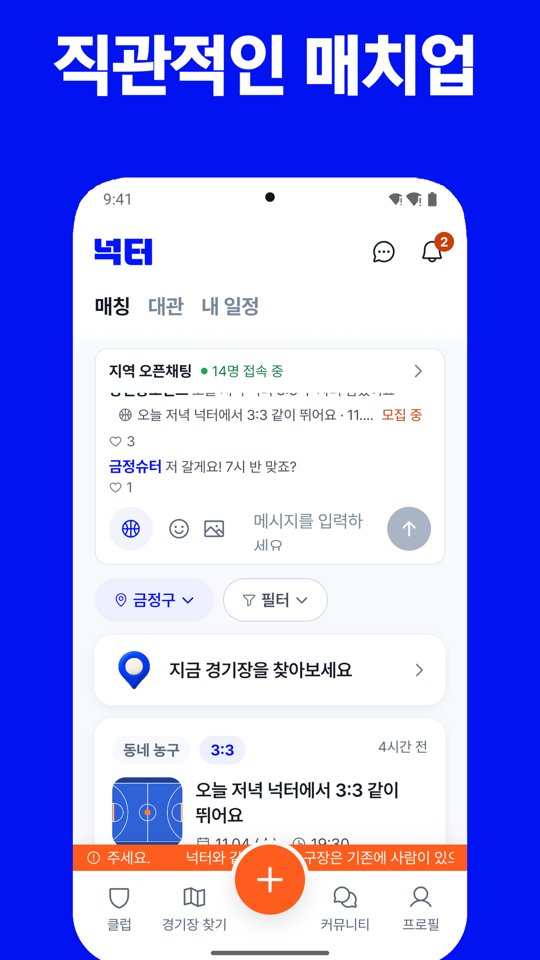
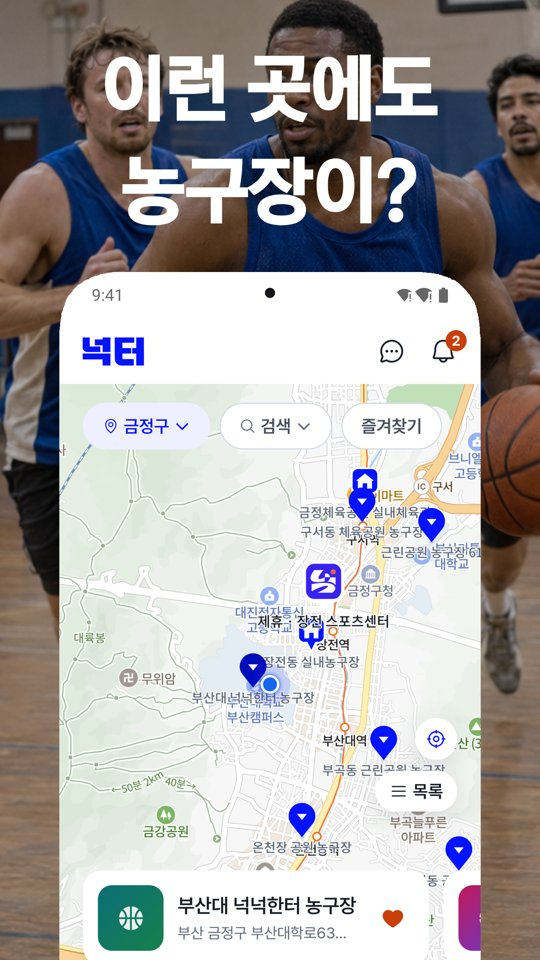
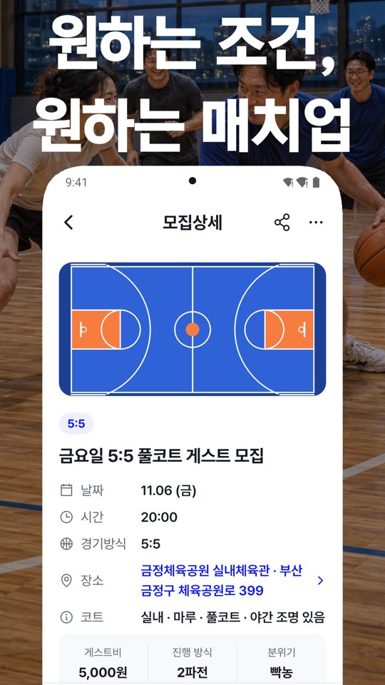
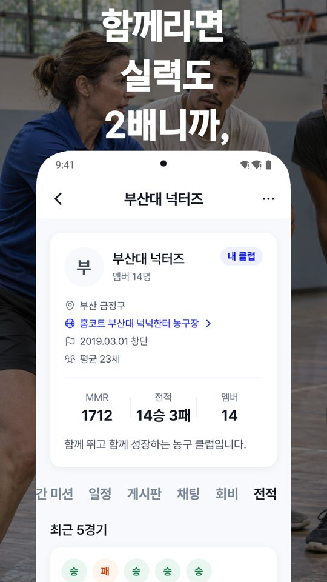
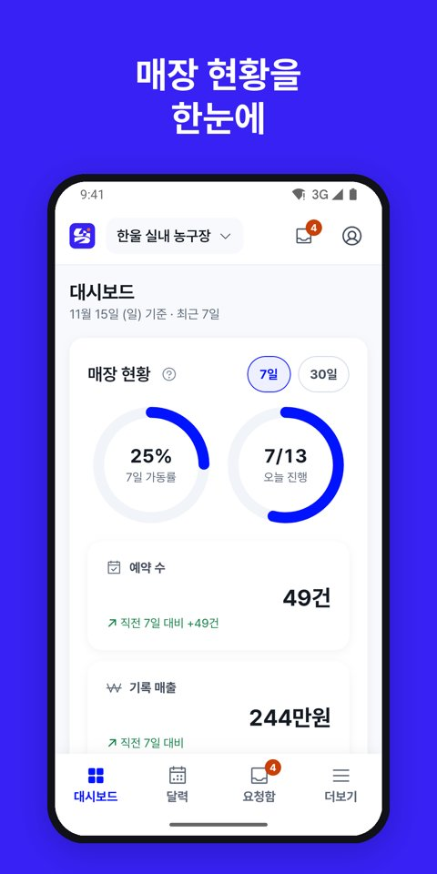
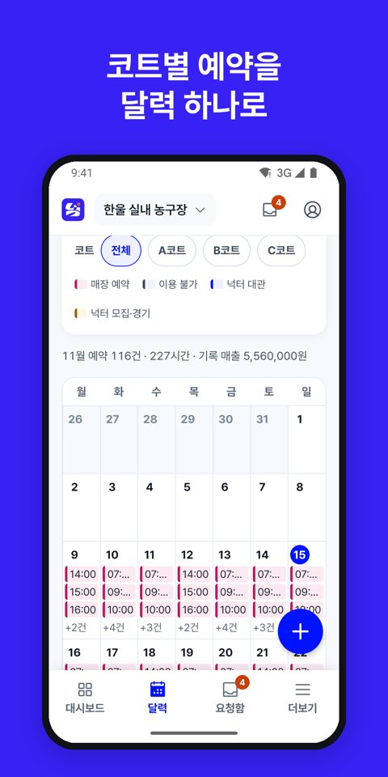

<p align="center">
  
</p>

<h1 align="center">넉터(NUKTU)</h1>

<p align="center">농구가 하고 싶은 순간, 같이 뛸 사람과 코트를 찾는 농구 매칭 앱<br><a href="https://apps.apple.com/kr/app/id6801552960">App Store</a> · <a href="https://play.google.com/store/apps/details?id=com.pnu.basketball">Google Play</a> · <a href="https://app.nuktu.com">웹 앱</a> · <a href="https://nuktu.com">서비스 소개</a></p>

> **요약** (기준일 2026-11-22)
>
> - 게스트 모집, 경기 매칭, 경기장 찾기, 체육관 대관을 앱 1개에서 처리하는 농구 매칭 서비스
> - 2026-08-19 App Store, Google Play 출시 후 운영 중. iOS, Android, 웹을 코드 1벌로 배포하고 제휴 체육관용 파트너 앱을 별도 제공
>
> | 지표 | 값 | 비교 기준 |
> |---|---|---|
> | 가입 회원 | 485명 | 2026-08-19 출시 후 95일 |
> | 등록 경기장 | 139곳 | 2026-11-18 운영 DB |
> | 개설 클럽 | 41개 | 2026-11-18 운영 DB |
> | App Store 스포츠 일간 순위 | 53위 | 2026-09-02 |

https://github.com/user-attachments/assets/3f51ad84-c503-43cd-b3f1-946e14207451

## 1. 문제 개요

**1-1. 농구 동호회 운영진은 게스트 모집, 친선전 상대 섭외, 체육관 대관을 단톡방과 전화로 조율합니다.**

창업팀 조사에서 운영진 1명이 경기 1회 일정을 확정하는 데 1~2시간 이상을 썼습니다. 단체방 공지, 답장 대기, 개별 전화가 반복되는 동안 경기 시작이 늦어집니다.

| 참여자 | 불편 | 넉터의 대응 |
|---|---|---|
| 개인 플레이어 | 같이 뛸 사람과 가까운 코트를 찾기 어려움 | 빠른 매칭, 경기장 지도 |
| 동호회 운영진 | 게스트 모집과 친선전 섭외를 단톡방, 전화로 조율 | 모집글, 브릿지 매칭, 클럽 |
| 처음 만나는 상대 | 실력과 경기 이력을 미리 알 수 없음 | 티어, 경기 이력 |
| 제휴 체육관 | 예약 현황을 엑셀 표와 전화로 관리 | 파트너 앱, 대관현황표 사진 인식 |

## 2. 핵심 기능

**2-1. 플레이어는 모집과 매칭으로 경기를 만들고, 제휴 체육관은 파트너 앱으로 코트 예약을 관리합니다.**

| 기능 | 내용 |
|---|---|
| 게스트 모집 | 시간, 경기 방식, 포지션별 인원을 정해 모집글 등록. 등록 즉시 단톡방 개설, 경기 시작 30분 후 종료 |
| 브릿지 매칭 | 개설자가 직접 뛰지 않고 사람을 모아 연결하는 모집글. 지원 시 정보 전달 동의 필수 |
| 빠른 매칭 | 날짜, 시간, 경기 방식, 실력, 포지션 조건으로 대기 등록. 조건이 맞으면 경기 자동 생성 |
| 경기장 지도 | 전국 농구장 위치와 시설, 회원 경기장 추가(관리자 승인), 경기장 오픈채팅 |
| 학교 체육관 신청 | 학교 체육관 사용 허가 신청서 작성과 제출. 시간 배정과 허가는 학교 담당 |
| 티어와 경기 이력 | 13단계 티어(최근 단계 평가 10건 중앙값), 경기 이력, 후기 |
| 클럽과 커뮤니티 | 클럽 개설과 가입, 클럽전, 커뮤니티 글, 채팅 |
| 제휴 체육관 대관 | 파트너 앱으로 코트 예약, 정기 대여, 무통장입금 확인. 대관현황표 사진으로 일정 등록 |
| 넉넉이와 활동 레벨 | 활동 레벨에 따라 마스코트 넉넉이 성장, 크레딧으로 꾸미기 상점 이용 |
| 신고와 제재 | 신고 접수, 제재, 관리자 처리 |

| 홈 | 경기장 지도 | 모집 상세 |
|---|---|---|
|  |  |  |

| 클럽 | 파트너 앱 대시보드 | 파트너 앱 예약 달력 |
|---|---|---|
|  |  |  |

## 3. 해결 방법

**3-1. 빠른 매칭 등록 1회에 SQL 1,259개가 실행되어, 조회 방식과 매칭 작업 위치를 함께 바꿨습니다.**

후보자 변환 코드가 사용자마다 요약 조회를 따로 호출했고, 지역 전체 매칭 계산도 요청 스레드에서 처리했습니다. 사용자 요약은 일괄 조회로 바꾸고, 매칭은 등록 1건 기준 즉시 매칭과 60초 주기 지역 배치로 분리했습니다.

| 항목 | 수정 전 | 수정 후 |
|---|---|---|
| 요청당 SQL | 1,259개 | 25개 |
| 응답 시간 | 6.30초 | 0.51초 |
| 기존 테스트 | 197건 통과 | 197건 통과 |

주: 사용자 200명, 대기 60건, 모집글 15건 조건에서 측정함.

**3-2. 웹이 다른 도메인의 API를 호출해 요청마다 사전 요청(OPTIONS)이 붙어, Cloudflare Worker로 같은 도메인 경로를 만들었습니다.**

웹(`app.nuktu.com`)이 `api.nuktu.com`을 호출하면 인증 헤더가 있는 요청마다 사전 요청 291~375ms가 추가됐습니다. Worker를 `app.nuktu.com/api/*` 경로에 배치해 같은 도메인으로 요청하고, 사용자 IP 기록은 유지했습니다.

| 항목 | 수정 전 | 수정 후 |
|---|---|---|
| 로그인 요청 중앙값 | 276ms | 139ms |
| 사전 요청 | 요청마다 1회 | 0회 |

**3-3. 운영 서버 1대의 전체 장애에 대비해, 스탠바이 서버로 자동 전환하는 액티브-패시브 구성을 운영합니다.**

PostgreSQL 스트리밍 복제로 스탠바이 서버에 데이터를 유지하고, 운영 서버 장애가 감지되면 Cloudflare Worker가 API 요청을 스탠바이로 전환합니다. 배포는 blue/green 2개 슬롯으로 나눠 무중단 전환과 즉시 롤백을 지원합니다.

| 항목 | 값 | 기준 |
|---|---|---|
| 목표 RTO | 약 3분 | 장애 감지 임계 3분 |
| 목표 RPO | 수 초 | 비동기 복제 지연 |
| 스탠바이 재시작 반복 | 2,973회 → 0회 | 2026-11-14 읽기 전용 DB 백필 오류 수정 |

**3-4. 느린 회선에서 웹 첫 화면이 90초 넘게 멈춰, 글꼴 실패 시에도 진입하게 바꾸고 전송량을 축소했습니다.**

첫 화면 9,384KB 중 글꼴 파일이 5,388KB(57%)였고, 글꼴 로딩이 12초를 초과하면 화면에 진입하지 못했습니다. 글꼴은 woff2 3종과 한글 2,350자 부분 집합으로 축소하고, 화면별 코드 분할과 HTML 스플래시를 추가했습니다.

| 항목 | 수정 전 | 수정 후 |
|---|---|---|
| 첫 화면 전송량 | 9,384KB | 2,360KB |
| 글꼴 용량 | 5,388KB | 789KB |
| 1.6Mbps 회선 첫 글자 표시 | 120초 내 미표시 | 12.0초 |

**3-5. 체육관이 예약 현황을 엑셀 표로 관리해, 표 사진을 올리면 일정을 등록하는 인식 기능을 만들었습니다.**

후보 모델 11개를 같은 사진으로 비교하고, 오류 0건 모델 중 가장 저렴한 Gemini 3 Flash(preview)를 채택했습니다. 회전된 사진은 모든 모델에서 오류가 발생해, 업로드 화면에서 사용자가 90° 단위로 회전하게 했습니다.

| 항목 | 값 | 비교 기준 |
|---|---|---|
| 채택 모델 정확도 | 17/17 | 바로 선 사진 1장 기준 |
| 장당 비용 | $0.0144 | 대안 Claude Sonnet 5.5 $0.0344 |

## 4. 아키텍처

**4-1. 앱과 웹은 Cloudflare를 거쳐 운영 서버의 Spring Boot API에 연결되고, 운영 서버 장애 시 스탠바이 서버가 API를 인계합니다.**

- 보안상 제외함.

| 구성 | 역할 |
|---|---|
| Cloudflare Pages | 서비스 소개, 웹 앱, 파트너 웹 정적 배포 |
| Cloudflare Worker | API 요청 라우팅, 운영 서버 장애 시 스탠바이 전환, 웹의 같은 도메인 `/api` 경로 |
| 운영 서버 | nginx, API blue/green 2개 슬롯, PostgreSQL, Redis, 지표 수집 |
| 스탠바이 서버 | API 대기, PostgreSQL 비동기 복제본, PostHog 분석 |
| GitHub Actions, GHCR | 백엔드 이미지 빌드, main 기준 자동 배포 |
| EAS | iOS, Android 빌드와 스토어 제출, OTA 업데이트 |

## 5. 사용 기술

| 영역 | 기술 |
|---|---|
| 앱·웹 | React Native 0.86, Expo SDK 57, React 19, TypeScript(strict), Zustand, React Navigation |
| 실시간·지도 | STOMP WebSocket, 네이버 지도, 카카오 장소 검색 |
| 백엔드 | Java 17, Spring Boot 3.2, Spring Security(JWT), JPA, Flyway, ShedLock |
| 데이터 | PostgreSQL 17, Redis 7.4, AWS S3 |
| 인프라 | Docker Compose, nginx blue/green, Cloudflare Pages·Workers, PostgreSQL 스트리밍 복제 |
| 빌드·배포 | GitHub Actions, GHCR, EAS Build, Expo Updates |
| 관측·분석 | Sentry, Prometheus, Grafana, PostHog |
| 외부 연동 | 카카오·구글·애플 로그인, Firebase Cloud Messaging, Gemini API |

## 6. 프로젝트 구조

| 저장소 | 내용 |
|---|---|
| [Frontend](https://github.com/NUKTU/Frontend) | 넉터 앱·웹(React Native, Expo). iOS, Android, 웹 코드 1벌 |
| [Backend](https://github.com/NUKTU/Backend) | Spring Boot API, WebSocket 채팅, 매칭 배치, 푸시 알림 |
| [Partner](https://github.com/NUKTU/Partner) | 제휴 체육관 예약 관리 앱·웹 |
| [company-site](https://github.com/NUKTU/company-site) | 서비스 소개 사이트(nuktu.com) |
| [analytics](https://github.com/NUKTU/analytics) | PostHog 분석 서버 설정과 한국어 지표 페이지 |
| [docs](https://github.com/NUKTU/docs) | 개발·운영 문서, 기술 선택 기록 59건, 장애 기록 77건 |
| [design](https://github.com/NUKTU/design) | 디자인 원본, 마스코트, 스토어 이미지, 시안 |
| [ML](https://github.com/NUKTU/ML) | 유소년 농구 코칭 AI 연구: 슛 판정, 경기 영상 선수별 분석 |

주: 저장소 8개는 모두 비공개이며 조직 구성원만 열람 가능함.

```text
Backend/
├── src/main/java/com/pnu/basketball/
│   ├── controller/   REST, WebSocket 엔드포인트
│   ├── service/      매칭, 모집, 클럽, 대관, 채팅, 알림 도메인 로직
│   ├── domain/       JPA 엔티티
│   ├── repository/   데이터 접근
│   └── config/       보안, 비동기, 스케줄 설정
└── src/main/resources/db/migration/   Flyway 마이그레이션 188개
Frontend/
├── src/screens/      화면(매칭, 모집, 경기장, 클럽, 채팅, 커뮤니티, 프로필 등)
├── src/services/     REST, STOMP, 소셜 로그인, 푸시
├── src/store/        Zustand 스토어(인증, 세션, 지역)
└── src/navigation/   탭 5개와 스택 라우팅
Partner/
├── src/screens/      대시보드, 예약 달력, 예약 요청, 직원·매장 설정
├── src/api/          넉터 백엔드 파트너 API 호출
└── src/push/         기기별 푸시
```
